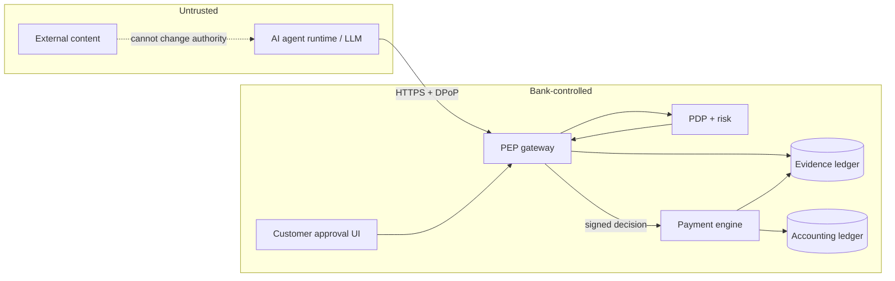
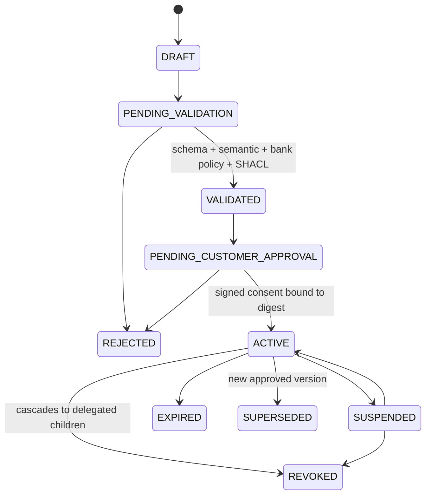

# Architecture

Modular monolith (ADR-0001). Logical components map to modules:

| # | Component | Module |
|---|---|---|
| 1 | Customer Identity Service | `kyc`, `auth` |
| 2-3 | Agent Registry; Identity & Attestation | `agents` |
| 4 | Mandate Compiler | `cnl`, `mandates.compile_full` |
| 5 | Mandate Ontology Service | `ontology_service`, `packages/ontology` |
| 6 | Mandate Registry | `mandates` |
| 7 | Customer Consent Service | `mandates.approve`, `approvals` |
| 8 | OAuth Authorization Server integration | `oauth` (sandbox adapter) |
| 9 | Policy Decision Point | `policy` |
| 10 | Policy Enforcement Point | `gateway` |
| 11 | Transaction Risk Engine | `risk` |
| 12 | Human Approval Service | `approvals` |
| 13 | Simulated Open Banking Gateway | `gateway` + `app` (`/bank/*`) |
| 14 | Simulated Payment Execution Engine | `bank` |
| 15 | KYM Evidence Ledger | `ledger` |
| 16 | Dispute Reconstruction Service | `disputes`, `responsibility` |
| 17 | Regulatory Control Mapping Service | `compliance`, `policies/` |

## Execution sequence

```mermaid
sequenceDiagram
    autonumber
    participant C as Customer (bank portal)
    participant A as Agent (HTTP only)
    participant AS as Sandbox OAuth AS
    participant G as Gateway / PEP
    participant P as PDP + Risk
    participant H as Human approval
    participant E as Payment engine
    participant L as Evidence ledger
    C->>AS: approves PAR-pushed request (RAR bound to ACTIVE mandate)
    AS-->>A: DPoP-bound JWT (mandate id/version/digest, act, cnf)
    L-->>L: TOKEN_ISSUED
    A->>G: POST /bank/payments (token + DPoP proof + Idempotency-Key)
    G->>G: verify token, audience, actor binding, DPoP, revocation list
    G->>L: ACTION_REQUESTED
    G->>P: snapshot (customer, agent, account, mandate chain, usage, risk, approval)
    P-->>G: ALLOW | DENY | REQUIRE_HUMAN_APPROVAL | REFER_TO_RISK_REVIEW + trace
    G->>L: POLICY_EVALUATED, RISK_EVALUATED
    alt REQUIRE_HUMAN_APPROVAL
        G->>H: approval bound to SHA-256(operation)
        H-->>G: approvals (distinct signatories) — agent resubmits with approval_id
    end
    G->>E: execute(op, signed single-use decision certificate)
    E->>E: verify signature, expiry, op_hash, single use; reserve; post balanced entries
    E->>L: PAYMENT_EXECUTED (same transaction)
```

## Trust boundaries



The agent never has database or payment-engine access. The payment engine rejects any request without a valid decision certificate (ADR-0001, `tests/security`).

## Lifecycle of a mandate



Every transition writes an evidence event; illegal transitions are rejected server-side (`mandates.TRANSITIONS`).

## Effective authority

`customer authority ∩ agent capabilities ∩ OAuth ∩ active mandate ∩ every parent mandate ∩ bank policy ∩ risk ∩ operational restrictions`. Evaluation order and reason codes: `policy.py`. Precedence of outcomes: `DENY > REFER_TO_RISK_REVIEW > REQUIRE_HUMAN_APPROVAL > ALLOW`.

## Data stores

* Mutable: customers, accounts, agents, mandate *state*, tokens (hash only), approvals, transactions, decisions (full input snapshots), accounting postings.
* Immutable: mandate versions (content + digest), consents, evidence events and payloads (payload erasable), checkpoints.
* Files (demo): keys and exported checkpoints in `.kym-data/`.
